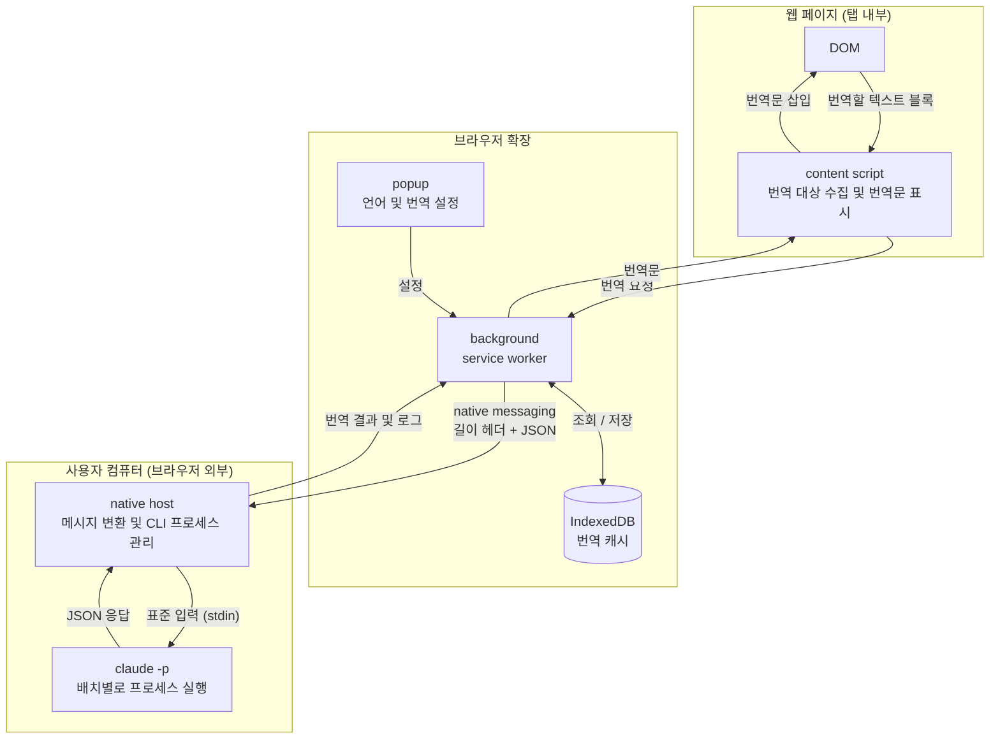
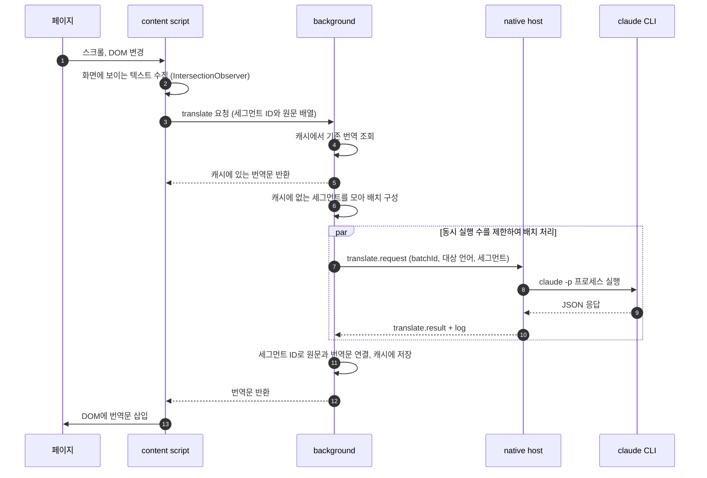

# Opener

Opener는 사용자 컴퓨터에 설치된 AI CLI를 통해 웹 페이지를 번역하는 브라우저 확장입니다. 예를 들어 Claude Code를 사용하면, 브라우저가 로컬 프로그램인 native host를 실행하고 이 프로그램이 `claude` CLI에 번역을 요청합니다.

- 번역 요청은 별도의 Opener 서버를 거치지 않고 로컬 CLI로 전달됩니다. CLI가 원격 AI 서비스를 사용하면 번역할 텍스트는 해당 서비스로 전송됩니다.
- 인증은 CLI의 기존 로그인 설정을 따릅니다. 확장은 API 키나 로그인 토큰을 직접 읽거나 저장하지 않습니다.
- native host에는 연결을 허용할 확장 ID를 등록합니다. 브라우저가 이 ID를 확인하므로 확장과 호스트 사이에 별도의 인증 토큰을 두지 않습니다.

현재는 확장의 기본 구성과 브라우저 테스트 환경, Claude·Codex를 호출하는 native host를 구현한 단계입니다. 확장의 번역 기능과 host 연결은 아직 구현 전입니다. 아래는 전체 구조와 처리 방식이며, CLI 호출 예시는 `claude`를 기준으로 작성했습니다. host 실행과 검증 방법은 [native host 안내](packages/native-host/README.md)를 참고합니다.

## 구성요소



content script는 페이지의 DOM에 접근해 번역할 텍스트를 수집하고 번역문을 표시합니다. CLI와의 통신은 background와 native host를 거칩니다. content script에서는 `connectNative`를 호출할 수 없고, background에서는 페이지의 DOM에 직접 접근할 수 없으므로 두 스크립트가 메시지로 요청과 결과를 주고받습니다.

| 구성요소       | 실행 위치                           | 역할                                                                 |
| -------------- | ----------------------------------- | -------------------------------------------------------------------- |
| content script | 각 탭의 웹 페이지                   | 텍스트 블록 수집, 번역 요청 생성, DOM에 번역문 삽입                  |
| background     | 확장의 service worker               | 캐시 조회, 요청을 배치로 묶어 전달, 처리 완료 여부 확인              |
| popup          | 확장 아이콘을 눌렀을 때 표시되는 창 | 언어 선택, 번역 켜기·끄기, 상태 표시                                 |
| native host    | 브라우저가 실행하는 별도 프로세스   | native messaging 메시지와 CLI 입출력 형식 간 변환, CLI 프로세스 관리 |
| `claude` CLI   | 사용자 계정으로 실행되는 프로세스   | 번역 요청 처리                                                       |

## 번역 처리 흐름

수집한 텍스트는 번역 단위인 세그먼트로 나누고, 각 세그먼트에 ID를 부여합니다. 여러 세그먼트를 하나의 CLI 호출로 처리하도록 묶은 단위를 배치라고 합니다.



여러 배치를 동시에 실행하면 요청한 순서와 응답이 도착하는 순서가 다를 수 있습니다. 모델이 배치 안의 번역문 순서를 바꾸는 경우도 있으므로, 각 번역문은 세그먼트 ID를 기준으로 원문과 연결합니다. 요청한 ID가 응답에서 누락되면 해당 배치를 실패로 처리합니다.

캐시는 배치를 구성하기 전에 조회합니다. 저장된 번역문이 있으면 바로 반환하고, 나머지 세그먼트만 CLI에 요청합니다.

## CLI 연동 및 번역 설정

- native host는 부모 프로세스의 환경 변수를 상속해 `claude`를 실행합니다. `~/.claude`를 직접 읽지 않으며, 확장과 호스트 간 메시지에도 인증 토큰을 포함하지 않습니다. 확장에 API 키를 입력할 필요도 없습니다.
- native host의 이름은 `com.opener.native_host`로 등록합니다. 다른 제품의 호스트 등록 파일(manifest)을 덮어쓰지 않습니다.
- CLI 호출에는 문서화된 `claude -p` 명령과 공개 옵션만 사용합니다.
- 전체 페이지 자동 번역은 기본으로 꺼 두고, 사용자가 켰을 때만 실행합니다.
- 같은 텍스트를 반복해서 번역하지 않도록 번역 결과를 캐시에 저장합니다.

## 저장소 구조

```text
apps/
  extension/     WXT + React 브라우저 확장
  web/           Next.js 소개 사이트
packages/
  native-host/   native messaging 입출력, Claude·Codex 호출 및 결과 검증
  protocol/      확장과 native host가 공유하는 메시지 타입 및 요청 검증
```

두 패키지는 독립적으로 버전을 관리합니다. native host는 Node.js 표준 모듈만 사용하며, 요청마다 CLI 프로세스를 새로 실행합니다.

## 개발

개발과 CI는 `.nvmrc`에 고정한 Node.js 22 버전을 사용합니다. pnpm 버전은 `package.json`의 `packageManager`를 따릅니다.

```bash
nvm install        # .nvmrc의 버전 설치 (이미 설치되어 있으면 재사용)
nvm use
pnpm install
pnpm dev:ext        # 확장 개발 서버
pnpm dev:web        # 웹 개발 서버
pnpm test           # Vitest로 확장(Chromium)과 native host(Node.js) 테스트 실행
```

디렉터리 진입 시 Node 버전을 자동으로 전환하려면 [nvm의 zsh 자동 전환 설정](https://github.com/nvm-sh/nvm#zsh)을 사용합니다.

### 커밋·푸시 전 검사

`pnpm install` 시 Lefthook이 Git 훅을 설치합니다.

- 커밋 전: 스테이징한 파일의 Prettier 검사와 앱별 JS·TS 파일의 ESLint 검사를 병렬 실행합니다.
- 커밋 메시지: Conventional Commits 형식을 검사합니다. 예: `feat: 번역 기능 추가`, `fix(extension): 팝업 오류 수정`, `chore: 의존성 업데이트`.
- 푸시 전: `pnpm typecheck`로 웹과 확장 프로그램의 타입을 검사합니다.

검사 실패 시 내용을 수정한 뒤 다시 커밋하거나 푸시합니다. 포맷은 `pnpm format`, 린트 자동 수정은 `pnpm lint:fix`로 실행할 수 있습니다.

### 브라우저 테스트

DOM 테스트는 jsdom 대신 실제 Chromium에서 실행합니다. 번역할 요소를 찾는 기능은 요소의 스타일과 화면 내 위치에 의존하므로, `getComputedStyle`과 `IntersectionObserver`를 실제 브라우저 환경에서 검증할 수 있어야 합니다.

E2E 테스트는 확장을 빌드한 뒤 테스트용 HTML 서버와 확장이 설치된 Chromium을 실행합니다. 테스트가 끝나면 서버와 브라우저도 종료합니다.

```bash
pnpm --filter @opener/extension exec playwright install chromium # 최초 한 번
pnpm test:e2e
pnpm test:e2e --headed # 브라우저 창을 보면서 실행
```

- 확장 흐름 검사: 현재는 실제 native messaging 연결은 검증하지 않습니다.
